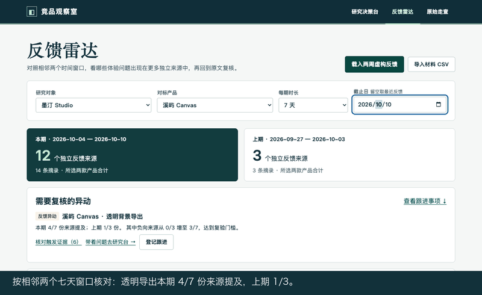

# AI 产品运营与项目管理作品集

两个独立的本地 Web 项目，分别展示竞品研究中的产品取舍，以及研发交付中的版本核对。均为离职后根据过往项目场景重新实现，演示数据全部虚构。

## 竞品研究：下一轮迭代应该先改什么？

[播放反馈与 DeepSeek 研究分镜（MP4）](https://raw.githubusercontent.com/hqian154376/ai-product-ops-portfolio/main/media/feedback-to-decision.mp4) · [用户流程与架构图](competitor-insights-demo/ARCHITECTURE.md) · [模型实测记录](competitor-insights-demo/MODEL-RUN.md) · [启动项目](competitor-insights-demo/)

先从反馈发现问题，再把问题带入产品研究。样例里，溪屿透明背景导出从上期 3 份来源中的 1 份提及，变为本期 7 份中的 4 份。打开失败和成功的原文，看看渠道构成，登记跟进，最后检查一次实际导出的 PNG，核对“透明背景变白”在什么条件下可以复现。另一条研究线展示墨汀的编辑断点如何随版本变化，以及选区边界是否还值得优先验证。

DeepSeek 在用户提出研究问题后主动查询统计与原文，给出下一步实验。窗口、独立来源数、能力状态、可引用范围和报告快照由本地程序维护。首次体验可直接打开竞品源码包中的 `static/model-replay.html`，在同一页查看真实模型的 5 次调用并点到原文。要比较另一组材料，启动研究台即可在本地复算，也可以接自己的模型重新提问。[七项能力与版本复验分镜（MP4）](https://raw.githubusercontent.com/hqian154376/ai-product-ops-portfolio/main/media/research-workbench.mp4) · [竞品研究操作示例](competitor-insights-demo/DEMO.md)

## 项目台账：这次发布以后，哪个版本仍然有效？

[项目管理台账与运行说明](project-tracker-demo/) · [项目进度与发布回执操作示例](project-tracker-demo/DEMO.md)

打开任一项目即可核对负责人、里程碑、风险、下一步和正式版本。在样例项目上先提交一次成功回执，再提交一次失败回执，可以看到两次尝试的记录，正式版本仍取最近一次成功发布的版本。可进一步接入个人飞书的一张多维表格，验证进度导入和版本回写。

[此前的双项目演示实录（MP4）](media/portfolio-demo.mp4) 展示原始走查页面上的 DeepSeek 工具调用，以及台账的发布与飞书同步。两个项目首次安装依赖后均可离线演示。
