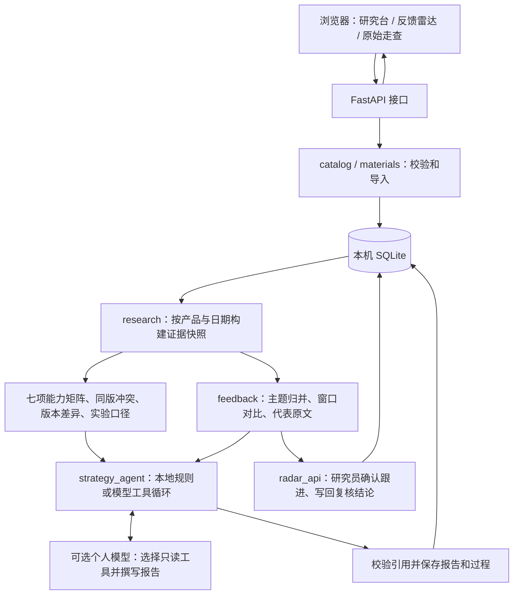

# 从一条反馈到一次产品决策

研究员要回答的是一个可执行的问题：**下一轮该修哪里、为什么、怎么知道修好了？** 工作台保留两条证据链。使用者的描述用来发现值得调查的主题，同条件的操作走查用来验证具体版本的表现。两条链在能力矩阵和研究报告中汇合；一个人多次提及同一问题，可以说明体验细节，不能算作多个独立来源。

## 使用流程

| 研究员的动作 | 系统实际执行 | 能带走的结果 |
| --- | --- | --- |
| 选两款产品、研究目标和截止日 | 从 SQLite 取观测与来源材料，按产品、材料日期和版本计算七项能力 | 一张带原文出处的对标矩阵，空白能力标作待补证据 |
| 导入走查、公告或用户反馈 | 检查产品、日期、字段和稳定编号，整个文件通过后才写入 | 可复用的研究资料；重复导入同一来源摘录不会增加来源数 |
| 在「反馈雷达」选窗口 | 按能力、中文短语和保守的连续双字近似规则归类反馈，按产品和渠道统计相邻两个等长窗口的独立来源、样本占比与正负体验 | 哪个问题集中出现、样本基数有多大、代表原文是什么 |
| 从异动创建跟进，或带着主题继续研究 | 固定触发日期及证据。在研究台继承比较对象、窗口和问题，避免研究设置发生偏移 | 一项能追溯到来源的待办，或一个有上下文的研究问题 |
| 生成报告、点击引用 | 规则或个人模型在同一份研究快照上工作；服务核验模型引用，保存报告、原文、范围和过程 | 可重开的报告、Markdown 导出、可检查的工具记录 |
| 做一次定向复测，再决定怎么处理 | 导入实测记录，比较版本或同版在不同日期的结果。研究员填写处理结论 | 已修复项成为回归用例，条件冲突的同版结果继续复测，跟进记录可挂上同产品、同能力的实测原文；触发时的证据与复核证据分别冻结 |

## 模块如何调用

这是一个 FastAPI 进程和一份 SQLite 文件。CSV 导入、矩阵计算、反馈聚合和报告保存都可以在个人电脑上运行。网页通过同源 API 操作。只有启用个人模型时，后端才将研究问题和该次工具返回的材料发送给配置的模型服务。

**一份来源怎样计数。** 未填写渠道时归入“未知”。同一来源的多段摘录只算一份；同一期有不同已知渠道标记的同一来源单列为“混合”，避免重复增加总数。可以同时在全产品和单主题范围检查渠道构成，这能解释采样偏差。

## 大模型参与哪一步

| 步骤 | 执行者 | 原因 |
| --- | --- | --- |
| 产品身份、版本、日期、来源去重、窗口分母、能力状态 | Python 与 SQLite | 同一批输入应能复算。即使模型措辞发生变化，数据和状态仍可核查。 |
| 判断问题需要哪些资料、追问历史、选出能支持或反驳结论的原文 | 配置的模型 + 后端只读工具 | 模型按问题在有限范围内取证。读取材料目录与打开原文分别记录。 |
| 对比、解释证据分歧、提出实验 | 模型或离线规则 | 模型可处理自由提问。离线版按选定意图和可识别的能力词分析，同一批输入可以复算。 |
| 引用核验、报告保存、导出 | 后端 | 模型引用须来自本轮实际打开的快照原文。引用通过只说明出处有效，研究者仍可核对推断是否恰当。 |
| 修改材料、改变跟进状态、决定是否上线修复 | 研究员 | 指标和产品建议可以辅助判断。修改数据与确认复核结论均有单独的人为操作。 |

模型可用的五个只读工具分别是 `compare_capabilities`（能力矩阵）、`list_changes`（版本变化）、`read_feedback_trends`（本期与上期的反馈统计）、`find_evidence`（材料目录）及 `open_evidence`（原文）。模型发起调用，后端限定产品、日期和参数范围，并将真实结果交回下一轮。认证、超时、越界引用或多轮校验仍失败时，界面给出错误，失败内容不会成为已完成报告。

**报告里有两种出处。** 涉及反馈趋势时，程序从相同快照提供可复算的主题统计、分子分母、渠道和正反例。模型另行解释建议和实验。这两部分分别标注，程序列出的原文不会增加模型阅读量。可对照[一次真实 DeepSeek 运行](MODEL-RUN.md)查看区别。

## 如何读统计、分歧与历史

- **来源和摘录。** 每条摘录用证据编号定位；同一份访谈的多段话共用材料编号。主题卡按独立来源统计，并保留代表摘录供复核。同一来源可讨论多个主题，各主题占比不宜直接相加。
- **反馈趋势。** 统计的是该产品在选定时间窗口内导入的反馈样本，分母为同产品、同窗口的独立来源。小样本、新出现主题和已有多期支持的变化需要分别解释。样本占比不能外推成全部用户的发生率、DAU 或市场份额。
- **能力对标。** 同版实测优先描述这次任务的实际表现，公告和反馈中的不同说法继续保留。同一版本在两天测出相反结果，提示核对输入与条件；有前后版本实测才能支持版本修复判断。
- **两种时间。** 截止日筛选的是材料日期。今天补录的旧材料可以改变今天对过去的还原。此前保存的报告冻结当时读到的原文、统计与结论，可用于回答“当时依据什么作判断”。
- **样例范围。** 所有样例都是虚构材料，数据来源由研究者导入。统计窗口随选定的材料或走查日期变化。

## 代码入口与复现

| 文件 | 核心职责 |
| --- | --- |
| [catalog.py](insights/catalog.py)、[materials.py](insights/materials.py) | 走查和来源导入、SQLite、报告快照 |
| [research.py](insights/research.py) | 时间截面、能力判断、同版分歧、前后版本与实验口径 |
| [feedback.py](insights/feedback.py) | 反馈归并、相邻时间窗统计、独立来源与代表证据 |
| [radar_api.py](insights/radar_api.py) | 雷达查询与异动跟进 |
| [strategy_agent.py](insights/strategy_agent.py)、[app.py](insights/app.py) | 模型工具 / 离线分析、引用校验、研究接口、存取与导出 |
| [static/](static/) | 研究决策台、反馈雷达与原始走查界面 |

按[运行说明](README.md)启动应用，再用[版本走查与反馈复核教程](DEMO.md)导入新证据，比较更新前后的结论，重开历史报告核对当时的判断。
# 新增：资料采集上游

[公开网页采集架构与演示](COLLECTION.md)补齐了人工来源清单 → 采集 Agent 调工具 → HTTPX 抓取 → Trafilatura 正文提取 → 内容快照与去重 → 人工确认与失败补充 → 统一 CSV → 证据库的链路。下方研究 Agent 继续负责取证、比较和建议。上游支持两类采集工具，下游支持五类只读研究工具。
