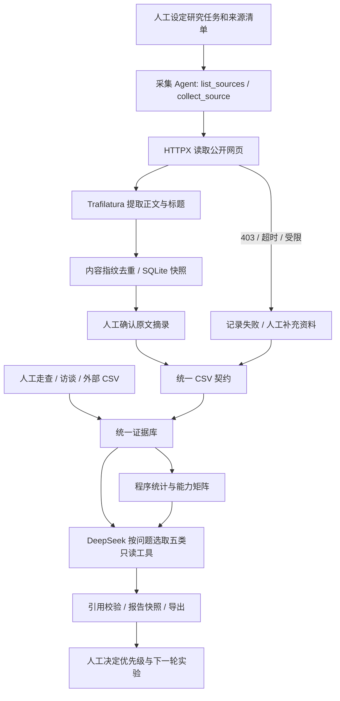

# 从公开资料到产品研究

现在可在首页点击「来源采集」，让 DeepSeek 采集 Agent 查看人工配置的来源清单并调用抓取工具。程序清洗正文、去重并保存快照；人工确认摘录，受限或失败的来源按同一模板人工补充，最终以统一 CSV 交给研究 Agent。页面同时支持直接批量采集，便于无模型时使用。

## 一次完整演示

1. 启动项目，打开 `/static/collection.html`，点击「让采集 Agent 处理来源」。查看 `list_sources`、`collect_source` 的实际工具记录。无 Key 时用「一键采集全部来源」。当前配置为真实 Krita、GIMP 官方 PNG 文档；这两款图像工具用于演示真实采集，墨汀、溪屿用于演示虚构 AI 产品的版本变化。两组资料分别研究。
2. 查看正文、原始 URL、采集时间、内容指纹。确认每份资料中要使用的连续原文，点击「确认摘录并加入证据库」。可以修改预填摘录，但必须仍是该快照中的连续原文。
3. 再次采集 Krita 文档，内容未变化则复用原快照；正文变化会建立新快照并指向前一份。采集时间是抓取日期，不冒充文章发布日期；`manual-current` 表示未锁定发行版本的在线文档。
4. 点击「下载已确认资料 CSV」，核对与来源模板一致的字段。摘录在入库时也经过该 CSV 契约校验。点击「带着问题去研究台」，比较 Krita 与 GIMP 的 PNG 导出要求。模型调用只读研究工具、打开原文、给出引用。点击编号可查看本轮保存的摘录，也可以打开原始网页。在同一数据库无需重复导入；跨工作区可导入导出的 CSV，先登记对应产品。
5. 导出报告。网页以后改变，已保存报告仍保留当时的证据。官方文档只证明文档写了什么，没有任务走查时不能宣称体验实测通过。

## 架构和分工

上游采集 Agent 查看来源清单、选择调用抓取工具，底层下载和清洗由程序执行；下游研究 Agent 在审核后的资料中查证、比较和形成建议。两阶段共享 CSV 数据契约。Skill 是可复用的任务说明，可以指导如何做研究，但实际采集还需要可执行工具。

### 已实现的核心机制

- 来源登记：`insights/collection.py` 中 `SOURCES` 明确 URL、真实产品、文档版本和能力类别。新增来源需要改配置并重启，当前网页不接受任意 URL。
- 网页采集：HTTPX 读取公开 HTML，按 robots.txt 校验，限制响应大小及超时，不跟随重定向。遇到失败保留已有快照。
- 正文提取：接入 Trafilatura。HTML 中的导航和其他无关内容尽量过滤，正文不足时提示补充资料。
- 去重与快照：正文 SHA256 相同复用快照；内容变化保留前一快照编号。仅按内容变化建立记录，未提供定时调度和自动邮件提醒。
- 审核入库：必须选取采集正文中的连续原文。证据编号稳定，重复确认相同摘录不重复写入。不同摘录共用来源标识，材料数按来源去重。
- 证据边界：`documentation` 与走查、反馈、版本公告分开。未知不等于不支持；官方文档不转写成用户实测。

## 开源调研与选择

| 组件 | 适用场景 | 当前采用情况 |
| --- | --- | --- |
| [Trafilatura](https://github.com/adbar/trafilatura) / [正文提取文档](https://trafilatura.readthedocs.io/en/latest/extraction-overview.html) | 公开静态 HTML 的正文与元数据提取 | 已集成，当前默认实现 |
| [Crawl4AI](https://docs.crawl4ai.com/core/quickstart/) | 浏览器渲染、动态网页、按 CSS 或模型提取 | 已调研，未集成；遇到动态页面时可替换采集适配层 |
| [Firecrawl](https://docs.firecrawl.dev/features/scrape) | 网页转 Markdown/结构化输出、托管抓取 | 已调研，未集成；当前演示不依赖其服务 |

没有为了名称丰富引入多 Agent 框架、向量库和自动搜索。当前资料量用结构化条件检索即可核对来源；模型已有五类研究工具。扩充时优先补可靠来源及真实任务走查，再判断是否需要向量检索或复杂编排。

## 对应到实习场景怎么讲

已确认的工作应围绕“我提出研究问题、组织竞品资料、走查关键任务、提出产品方案并推进上线”展开。97 款产品、7 类能力、200 余条记录是历史研究矩阵的规模，不能直接说自动抓取了 97 个网站。

复刻作品可这样讲：

> 我把产品研究拆成采集和分析两阶段。先少量人工设定来源，采集 Agent 调用工具读取公开资料，程序提取正文、去重并保留快照；遇到网页受限或采集失败，我再人工补充。所有资料统一成 CSV，交给竞品分析 Agent，根据研究问题查版本、读原文、整理差异和下一步验证建议。关键结论仍由我结合实际走查复核。这个离职后复刻版可以从采集网页开始完整演示。

若在职时上游由同事提供表格或工作流，可按实际分工说明。尚未确认时不写同事使用了某种采集 Agent，也不把本次新增组件写成在职时使用的技术。

简历中的复刻作品候选表述：

> 基于实习产品研究场景复刻竞品研究 Agent，打通公开网页采集、正文提取、内容去重、证据审核及工具调用分析；支持五类研究工具、原文引用核验、版本复验与报告快照，可现场演示从资料获取到产品建议的流程。

## 本机验证结果

2026-11-24 在 Windows 浏览器真实运行 DeepSeek：采集 Agent 调用 `list_sources` 一次、`collect_source` 两次，处理两份公开来源。下载已确认的 CSV，再从研究台导入，已有相同证据不重复写入；下游模型实际读取 2 份去重材料、2 条原文、引用 2 条证据。原文弹窗可打开官方 URL，报告可导出。过程录屏见仓库首页。

49 项竞品项目测试通过，新增覆盖采集去重、正文变更快照、非原文摘录拒绝、CSV 导出解析、无走查的官方文档研究、robots 限制、重定向拒绝，以及采集 Agent 的失败记录。此轮真实网页均采集成功；403 场景由模拟测试验证，没有宣称本次遇到或突破了反爬。
